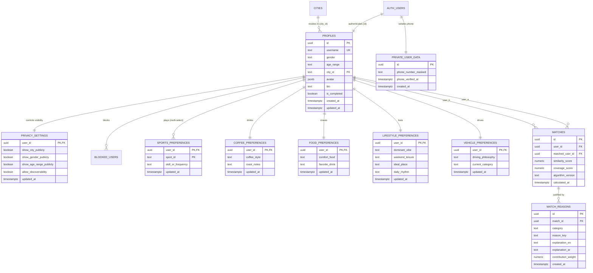

# TWIN: Database Schema & Entity Relationship Diagram (ERD)

## 1. Architectural Overview

The TWIN database is architected on **PostgreSQL (via Supabase)** using a strict Third Normal Form (3NF) relational design. It strictly enforces:
- **Phone Privacy Isolation**: Phone numbers and sensitive authentication credentials are never stored in public application tables.
- **Relational Integrity**: Foreign keys with `ON DELETE CASCADE` ensure orphaned records never exist.
- **Explainable Matching**: Match pairs and their contributing dimension reasons are stored with versioned algorithm metadata (`algorithm_version: 'v1.0'`).

---

## 2. Entity Relationship Diagram (Mermaid ERD)

---

## 3. Data Dictionary & Table Specifications

### 1. `cities`
- **Purpose**: Normalized geographic hub directory. Prevents spelling discrepancies and supports bilingual labels.
- **Columns**:
  - `id` (`TEXT PRIMARY KEY`): Unique lowercase slug (`riyadh`, `jeddah`, `dubai`, etc.).
  - `name_en` (`TEXT NOT NULL`): English display name.
  - `name_ar` (`TEXT NOT NULL`): Arabic display name.
  - `country_code` (`TEXT NOT NULL`): ISO 3166-1 alpha-2 code (`SA`, `AE`, `QA`, etc.).

### 2. `profiles`
- **Purpose**: Core public-facing identity. Linked 1:1 with `auth.users`.
- **Columns**:
  - `id` (`UUID PRIMARY KEY REFERENCES auth.users(id)`).
  - `username` (`TEXT UNIQUE NOT NULL`): Validated by regex `^[a-z0-9_]{3,20}$`.
  - `gender` (`TEXT CHECK (gender IN ('male', 'female', 'prefer_not_to_say'))`).
  - `age_range` (`TEXT CHECK (age_range IN ('18-23', '24-29', '30-35', '36-42', '43+'))`).
  - `city_id` (`TEXT REFERENCES cities(id)`).
  - `avatar` (`JSONB NOT NULL`): Structured vector parameters (skin tone, hair, clothing, accessory, mood).
  - `bio` (`TEXT`): Short introductory statement.
  - `is_completed` (`BOOLEAN DEFAULT false`): Indicates full onboarding readiness.

### 3. `private_user_data`
- **Purpose**: Sensitive user telemetry strictly quarantined from the public API.
- **Columns**:
  - `id` (`UUID PRIMARY KEY REFERENCES auth.users(id)`).
  - `phone_number_masked` (`TEXT`): Masked phone reference (e.g. `+966 ••• ••172`).
  - `phone_verified_at` (`TIMESTAMPTZ`): Timestamp of successful SMS OTP verification.

### 4. `privacy_settings`
- **Purpose**: Granular visibility switches respected by all query views and RPC functions.
- **Columns**:
  - `user_id` (`UUID PRIMARY KEY REFERENCES profiles(id)`).
  - `show_city_publicly` (`BOOLEAN DEFAULT true`).
  - `show_gender_publicly` (`BOOLEAN DEFAULT false`).
  - `show_age_range_publicly` (`BOOLEAN DEFAULT true`).
  - `allow_discoverability` (`BOOLEAN DEFAULT true`).

### 5. `sports_preferences` (Multi-Select)
- **Purpose**: Stores multiple active athletic and gaming pursuits for Jaccard overlap calculation.
- **Composite Primary Key**: `(user_id, sport_id)`.
- **Allowed values**: `sport_football`, `sport_padel`, `sport_gaming`, `sport_basketball`, `sport_gym`, `sport_running`, `sport_swimming`, `sport_other`, `sport_none`.

### 6. `matches` & `match_reasons`
- **Purpose**: Persisted pairwise similarity records for fast retrieval without recalculating on every render.
- **Constraints**:
  - `CHECK (user_id <> matched_user_id)`: Prevents self-matching.
  - `UNIQUE (user_id, matched_user_id)`: Prevents duplicate pairs.
  - `algorithm_version TEXT NOT NULL`: Guarantees reproducible scoring provenance.
